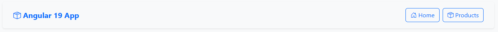
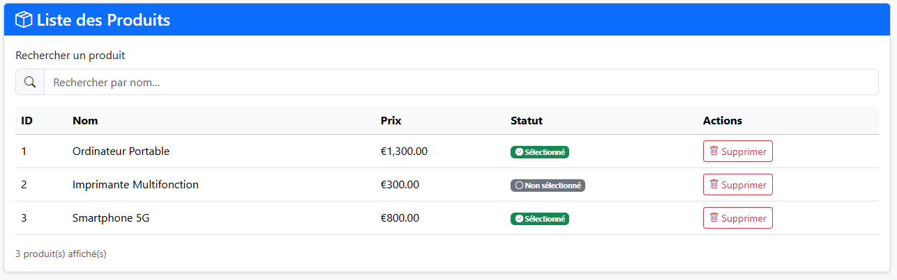
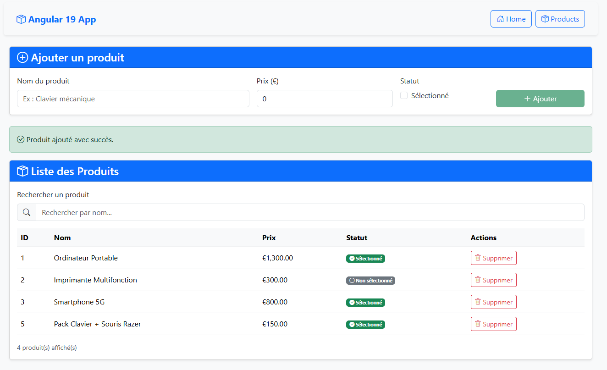
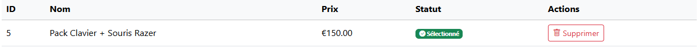
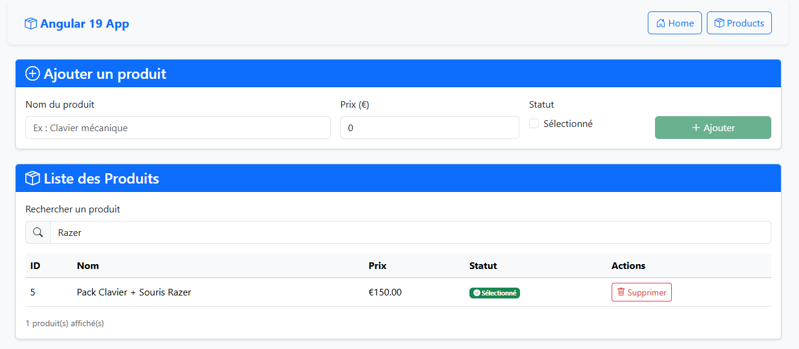
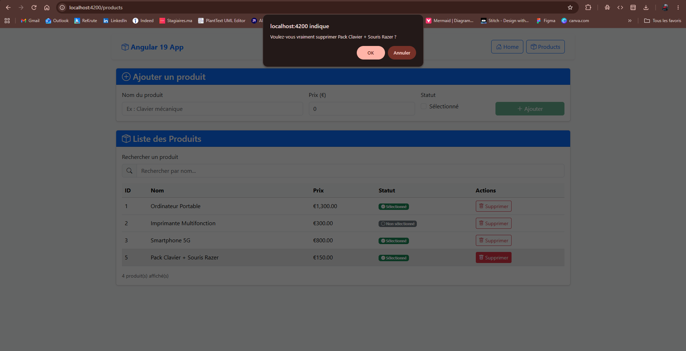
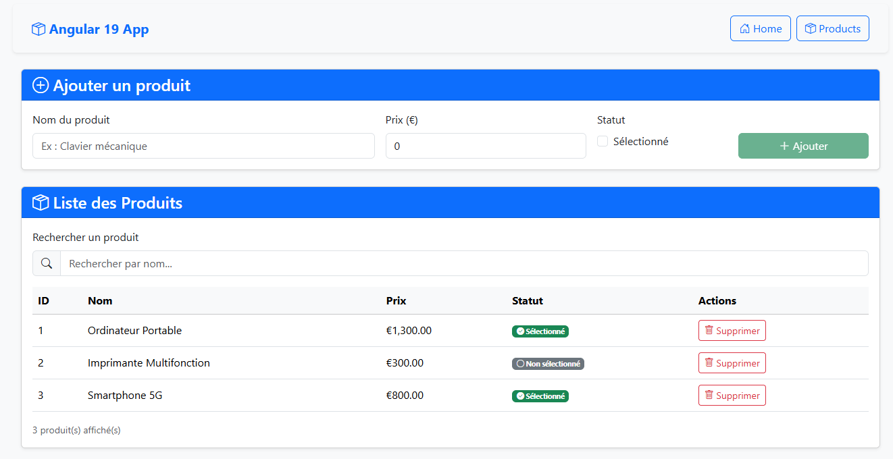

<div align="center">

# 📦 Gestion des Produits — Angular 19 & Spring Boot

### Activité Pratique N°3 — Framework Angular

**Application web de gestion des produits avec Angular 19, Bootstrap 5 et une API REST Spring Boot.**


**Réalisé par :** Mohamed Yawina  
**Établissement :** École Marocaine des Sciences de l'Ingénieur (EMSI)  
**Professeur :** Pr. Mohamed YOUSSFI  
**Année universitaire :** 2026–2027

</div>

---

## 📖 Présentation du projet

Ce projet a été réalisé dans le cadre de l'**Activité Pratique N°3 du module Angular Framework**.

L'objectif est de développer une application web permettant de gérer un catalogue de produits, en utilisant Angular 19 pour le frontend et Spring Boot pour le backend.

L'application permet de consulter, ajouter, rechercher, sélectionner et supprimer des produits à travers une interface responsive.

Ce TP met en pratique les concepts fondamentaux d'Angular moderne : composants Standalone, routage, services, injection de dépendances, directives de contrôle de flux, formulaires et communication HTTP.

---

## 🚀 Fonctionnalités

### Fonctionnalités principales

- Navigation entre les pages Home et Products.
- Affichage des produits dans un tableau Bootstrap.
- Affichage du nom, du prix et du statut de chaque produit.
- Utilisation des directives `@if`, `@for` et `@else`.
- Formatage des prix avec `CurrencyPipe`.
- Suppression d'un produit avec confirmation.
- Gestion des produits à travers un service Angular.
- Communication avec une API REST Spring Boot.
- Gestion des requêtes asynchrones avec RxJS.

### Exercices d'approfondissement

Les trois exercices supplémentaires demandés dans le TP ont également été réalisés.

**1. Ajout d'un produit**

- Formulaire utilisant `FormsModule` et `ngModel`.
- Saisie du nom, du prix et du statut.
- Validation des champs.
- Enregistrement avec une requête HTTP POST.

**2. Modification du statut**

- Badge cliquable pour modifier le statut `selected`.
- Passage entre « Sélectionné » et « Non sélectionné ».
- Mise à jour avec une requête HTTP PATCH.
- Actualisation du statut dans le tableau.

**3. Recherche dynamique**

- Barre de recherche par nom.
- Filtrage instantané pendant la saisie.
- Recherche insensible à la casse.
- Affichage du nombre de produits trouvés.

---

## 📸 Captures d'écran

### 1. Page d'accueil

Page principale de l'application avec une barre de navigation Bootstrap permettant d'accéder aux différentes sections.



### 2. Liste des produits

Affichage du catalogue sous forme de tableau avec les identifiants, noms, prix, statuts et actions disponibles.



### 3. Ajout d'un produit

Formulaire permettant d'ajouter un nouveau produit avec son nom, son prix et son statut.



### 4. Modification du statut

Modification du statut d'un produit directement depuis son badge à l'aide d'une requête HTTP PATCH.



### 5. Recherche dynamique

Filtrage des produits en temps réel à partir du nom saisi dans la barre de recherche.



### 6. Suppression d'un produit

Suppression d'un produit avec confirmation avant l'exécution de la requête HTTP DELETE.

**Confirmation de la suppression :**



**Résultat après suppression :**



---

## 🛠️ Technologies utilisées

### Frontend

| Technologie | Utilisation |
|---|---|
| Angular 19 | Framework frontend |
| TypeScript | Développement des composants et services |
| Bootstrap 5 | Mise en forme et interface responsive |
| Bootstrap Icons | Icônes de l'interface |
| Angular Router | Navigation entre les pages |
| Angular Forms | Gestion du formulaire d'ajout |
| HttpClient | Communication avec l'API REST |
| RxJS | Gestion des Observables |
| Angular Control Flow | Directives `@if`, `@for` et `@else` |

### Backend

| Technologie | Utilisation |
|---|---|
| Java 17 | Langage backend |
| Spring Boot | Développement de l'API REST |
| Spring Web | Création des endpoints HTTP |
| Maven | Gestion des dépendances |
| CORS | Autorisation des requêtes depuis Angular |

---

## 🏗️ Architecture de l'application

L'application repose sur une architecture frontend/backend.

```text
                  UTILISATEUR
                       |
                       v
              ANGULAR 19 (4200)
                       |
               ProductsComponent
                       |
                 ProductService
                       |
                HttpClient / RxJS
                       |
                 Requêtes HTTP
                       |
                       v
             SPRING BOOT (8083)
                       |
              ProductRestController
                       |
                Liste des produits
                  (en mémoire)
```

### Organisation du code

**Frontend Angular :**

- `HomeComponent` : page d'accueil.
- `ProductsComponent` : affichage et interactions avec les produits.
- `ProductService` : communication avec le backend.
- `app.routes.ts` : configuration des routes.
- `app.config.ts` : configuration de HttpClient et des fournisseurs Angular.

**Backend Spring Boot :**

- `Product` : modèle représentant un produit.
- `ProductRestController` : gestion des endpoints REST.
- `application.properties` : configuration du serveur.

---

## 📁 Structure du projet

```text
angular19-products-management-tp3/
│
├── inset-app/
│   ├── src/
│   │   ├── app/
│   │   │   ├── home/
│   │   │   ├── products/
│   │   │   │   ├── products.component.ts
│   │   │   │   ├── products.component.html
│   │   │   │   └── products.component.css
│   │   │   ├── services/
│   │   │   │   └── product.service.ts
│   │   │   ├── app.component.ts
│   │   │   ├── app.component.html
│   │   │   ├── app.routes.ts
│   │   │   └── app.config.ts
│   │   └── styles.css
│   ├── angular.json
│   └── package.json
│
├── products-backend/
│   ├── src/
│   │   ├── main/
│   │   │   ├── java/ma/emsi/productsbackend/
│   │   │   │   ├── ProductsBackendApplication.java
│   │   │   │   ├── model/
│   │   │   │   │   └── Product.java
│   │   │   │   └── web/
│   │   │   │       └── ProductRestController.java
│   │   │   └── resources/
│   │   │       └── application.properties
│   ├── pom.xml
│   └── mvnw.cmd
│
├── screenshots/
│   ├── 01-home.png
│   ├── 02-products.png
│   ├── 03-add-product.png
│   ├── 04-toggle-selection.png
│   ├── 05-search.png
│   ├── 06-delete01.png
│   └── 06-delete02.png
│
└── README.md
```

---

## ⚙️ Installation et exécution

### Prérequis

Avant de démarrer le projet, installer :

- Node.js compatible avec Angular 19.
- Angular CLI 19.
- Java JDK 17.
- Git.
- Un IDE comme Visual Studio Code ou IntelliJ IDEA.

### 1. Cloner le dépôt

```bash
git clone https://github.com/mohamed-yawina/angular19-products-management-tp3.git

cd angular19-products-management-tp3
```

### 2. Démarrer le backend Spring Boot

Accéder au dossier backend :

```bash
cd products-backend
```

Sous Windows :

```powershell
.\mvnw.cmd spring-boot:run
```

Le serveur démarre sur :

http://localhost:8083

Tester l'API REST :

http://localhost:8083/products

### 3. Démarrer le frontend Angular

Ouvrir un deuxième terminal :

```bash
cd inset-app
```

Installer les dépendances :

```bash
npm install
```

Démarrer Angular :

```bash
ng serve
```

Accéder à l'application :

http://localhost:4200

### 4. Accéder aux pages

| Page | URL |
|---|---|
| Accueil | http://localhost:4200/home |
| Produits | http://localhost:4200/products |
| API REST | http://localhost:8083/products |

**Important :** le backend Spring Boot doit être démarré pour permettre à Angular de récupérer et de modifier les produits.

---

## 🔗 API REST

Le backend expose les endpoints suivants :

| Méthode | Endpoint | Description |
|---|---|---|
| GET | `/products` | Récupérer tous les produits |
| POST | `/products` | Ajouter un produit |
| PATCH | `/products/{id}/selected` | Modifier le statut d'un produit |
| DELETE | `/products/{id}` | Supprimer un produit |

### Exemple de produit JSON

```json
{
  "id": 1,
  "name": "Ordinateur Portable",
  "price": 1300,
  "selected": true
}
```

### Exemple d'ajout avec POST

**Endpoint :**

```http
POST http://localhost:8083/products
```

**Corps de la requête :**

```json
{
  "name": "Clavier mécanique",
  "price": 150,
  "selected": false
}
```

### Exemple de modification du statut

**Endpoint :**

```http
PATCH http://localhost:8083/products/1/selected
```

**Corps de la requête :**

```json
{
  "selected": false
}
```

---

## 🧪 Tests et validation

Les fonctionnalités suivantes ont été vérifiées manuellement :

- Navigation entre Home et Products.
- Affichage des produits récupérés depuis Spring Boot.
- Affichage correct des prix et des statuts.
- Ajout d'un produit avec validation du formulaire.
- Modification du statut avec HTTP PATCH.
- Recherche dynamique par nom.
- Suppression d'un produit avec confirmation.
- Actualisation des données après les opérations.
- Communication HTTP entre Angular et Spring Boot.
- Compilation Angular avec `ng build`.

### Commandes de vérification

**Frontend :**

```bash
cd inset-app
ng build
```

**Backend :**

```powershell
cd products-backend
.\mvnw.cmd test
```

---

## 📚 Concepts Angular mis en pratique

### Composants Standalone

Utilisation de composants autonomes permettant de déclarer directement leurs dépendances sans créer de NgModule.

### Routage Angular

Configuration des routes avec `RouterLink` et `RouterOutlet` pour naviguer entre les pages.

### Directives de contrôle de flux

Utilisation des nouvelles syntaxes Angular :

- `@if` : affichage conditionnel.
- `@else` : affichage alternatif.
- `@for` : parcours des produits.
- `@empty` : gestion d'une liste vide.

### Services et injection de dépendances

Création de `ProductService` pour séparer la logique de communication HTTP de l'interface utilisateur.

### HttpClient et RxJS

Utilisation de `HttpClient` et des `Observable` pour effectuer les requêtes asynchrones vers l'API REST.

### Formulaires Angular

Utilisation de `FormsModule` et de `ngModel` pour réaliser une liaison bidirectionnelle entre les champs du formulaire et les propriétés TypeScript.

### CORS

Configuration de Spring Boot pour autoriser les requêtes provenant du frontend Angular.

---

## ⚠️ Limites actuelles

Cette application est un projet académique destiné à l'apprentissage d'Angular et de Spring Boot.

- Les produits sont stockés en mémoire dans le backend.
- Les données sont réinitialisées après le redémarrage de Spring Boot.
- Aucune authentification n'est implémentée.
- Aucune base de données persistante n'est utilisée.

### Améliorations possibles

- Intégration d'une base de données MySQL ou PostgreSQL.
- Utilisation de Spring Data JPA.
- Ajout de la modification complète d'un produit.
- Mise en place d'une pagination.
- Ajout de tests unitaires et d'intégration.
- Déploiement de l'application avec Docker.

---

## 🎓 Contexte académique

**Module :** Angular Framework  
**Activité :** Activité Pratique N°3 — Gestion des Produits  
**Professeur :** Pr. Mohamed YOUSSFI  
**Établissement :** EMSI — École Marocaine des Sciences de l'Ingénieur  
**Étudiant :** Mohamed Yawina  
**Année universitaire :** 2026–2027

Ce travail a permis de mettre en pratique les concepts d'Angular 19 et de comprendre la communication entre une application frontend et une API REST développée avec Spring Boot.

---

<div align="center">

**Projet académique réalisé dans le cadre du TP Angular Framework — EMSI**

Développé par **Mohamed Yawina**

</div>
